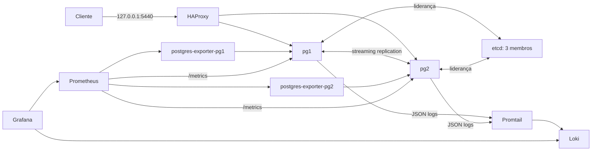

# Lab 06: Observability

Este lab evolui o cluster de alta disponibilidade com uma camada de observabilidade baseada em **Prometheus, PostgreSQL Exporter, Grafana, Loki e Promtail**. O objetivo é correlacionar métricas do banco e do Patroni com logs estruturados do PostgreSQL, visualizar o estado operacional e avaliar regras de alerta reproduzíveis.

## Arquitetura



Os exporters coletam estatísticas PostgreSQL com a role `monitor_user`, que possui `pg_monitor`, sem usar o superusuário. O Prometheus também coleta métricas nativas da API do Patroni. O PostgreSQL grava logs JSON em volumes separados; o Promtail os envia ao Loki. O Grafana é iniciado com datasources e dashboard já provisionados.

Somente HAProxy, Grafana, Prometheus e Loki publicam portas, todas em loopback. etcd, APIs do Patroni, exporters e Promtail permanecem na rede do Compose. Cada serviço mantém volumes próprios e o lab não reutiliza dados dos labs anteriores.

## Executar

Pré-requisitos: Docker com Compose, Bash, acesso à internet no primeiro build e recursos para 13 containers. Execute a partir deste diretório:

```bash
cp .env.example .env
# Substitua todas as senhas de exemplo; preserve um .env já existente.
docker compose build
docker compose up -d --wait --wait-timeout 300
bash scripts/check.sh
bash scripts/status.sh
```

Acessos locais padrão:

| Serviço | Endereço | Autenticação |
|---|---|---|
| PostgreSQL (escrita) | `127.0.0.1:5440` | `postgres` e a senha do `.env` |
| Grafana | `http://127.0.0.1:3000` | `admin` e `GRAFANA_ADMIN_PASSWORD` |
| Prometheus | `http://127.0.0.1:9090` | Sem autenticação, apenas loopback |
| Loki | `http://127.0.0.1:3100/ready` | Sem autenticação, apenas loopback |

No Grafana, abra a pasta **PostgreSQL Reliability Lab** e o dashboard **PostgreSQL Reliability — Overview**. Ele mostra disponibilidade, líder do cluster, conexões, tamanho do banco, transações, lag de replicação e logs.

## Gerar sinais observáveis

Para gerar transações e consultas lentas por 60 segundos:

```bash
bash scripts/generate_load.sh 60
```

O PostgreSQL registra consultas com duração mínima de 250 ms. O gerador inclui uma espera de 300 ms para produzir logs previsíveis. Em produção, limites, amostragem e conteúdo dos logs precisam ser dimensionados para custo, privacidade e volume.

Consultas úteis:

```promql
# Exporters PostgreSQL disponíveis
pg_up

# Papel observado pelo Patroni (exatamente um membro deve ser líder)
patroni_primary

# Transações confirmadas por segundo
rate(pg_stat_database_xact_commit{datname="appdb"}[1m])

# Diferença de WAL observada por membro
clamp_min(patroni_xlog_received_location - patroni_xlog_replayed_location, 0)
and on(node) (patroni_replica == 1)
```

```logql
# Todos os logs PostgreSQL
{job="postgresql"} | json

# Erros PostgreSQL
{job="postgresql", severity="ERROR"} | json

# Consultas registradas pelo limite de duração
{job="postgresql"} |= "duration:" | json
```

## Alertas

O Prometheus carrega regras para:

- exporter PostgreSQL indisponível;
- membro Patroni indisponível;
- ausência de líder observado;
- mais de 80 conexões por nó;
- lag de replicação superior a 16 MiB.

As regras demonstram detecção, mas este lab não inclui Alertmanager nem envio de notificações. Os limites são didáticos e não constituem SLOs. Em um ambiente real, derive-os de capacidade, baseline, orçamento de erro e impacto ao usuário.

## Validação e evidências

`scripts/check.sh` verifica:

1. dados, endpoint de escrita e streaming replication;
2. dois exporters PostgreSQL e exatamente um líder Patroni no Prometheus;
3. carregamento das regras de alerta;
4. saúde do Loki e do Grafana;
5. provisionamento do dashboard;
6. ingestão ponta a ponta de um log PostgreSQL identificado por token.

Cada execução bem-sucedida grava `evidence/<UTC>_observability.txt`. Esses arquivos são locais e ignorados pelo Git; o resultado curado da primeira execução está no [registro de validação](evidence/validation.md).

## Decisões e limites

- Prometheus e Loki usam armazenamento local e instância única. Não há alta disponibilidade, retenção de longo prazo nem object storage.
- Grafana, Prometheus e Loki não têm TLS. Prometheus e Loki não têm autenticação. As portas ficam em loopback e a configuração não deve ser publicada diretamente.
- `monitor_user` usa `pg_monitor`, que permite observar atividade e estatísticas sensíveis. A senha aparece na configuração resolvida do Compose e Docker não substitui um gerenciador de secrets.
- Logs de queries podem conter dados sensíveis. O lab usa dados sintéticos e não registra todas as instruções.
- O Promtail está em modo de manutenção de longo prazo no ecossistema Grafana; ele foi mantido aqui pela simplicidade didática. Para uma plataforma nova, avalie Grafana Alloy ou outro agente compatível.
- O dashboard usa métricas expostas pelas versões fixadas. Antes de atualizar imagens, valide nomes e semântica das séries.
- Uma tela verde comprova apenas os sinais coletados. Ela não substitui testes de recuperação, alertas exercitados, runbooks ou observabilidade da aplicação.

## Parar e remover

```bash
docker compose stop
docker compose up -d --wait --wait-timeout 300
```

Para apagar **todos os dados somente deste lab**, incluindo banco, métricas, logs e dashboards persistidos:

```bash
docker compose down -v
```

## Referências

- [PostgreSQL monitoring statistics](https://www.postgresql.org/docs/16/monitoring-stats.html)
- [PostgreSQL JSON log format](https://www.postgresql.org/docs/16/runtime-config-logging.html)
- [Prometheus configuration](https://prometheus.io/docs/prometheus/latest/configuration/configuration/)
- [Grafana provisioning](https://grafana.com/docs/grafana/latest/administration/provisioning/)
- [Loki configuration](https://grafana.com/docs/loki/latest/configure/)
